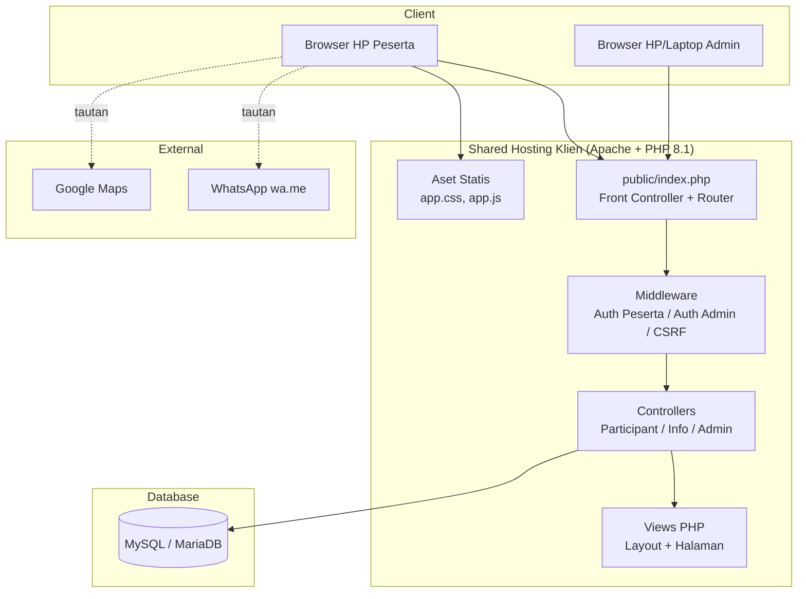
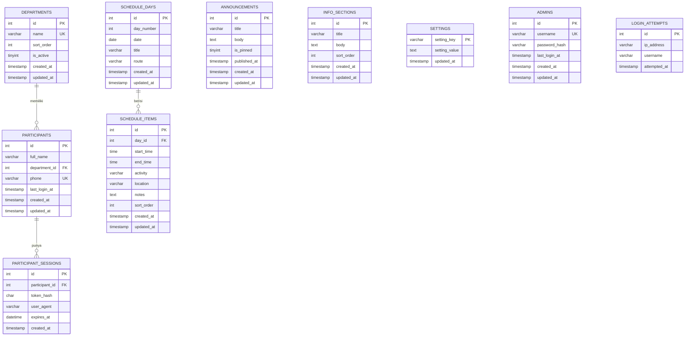
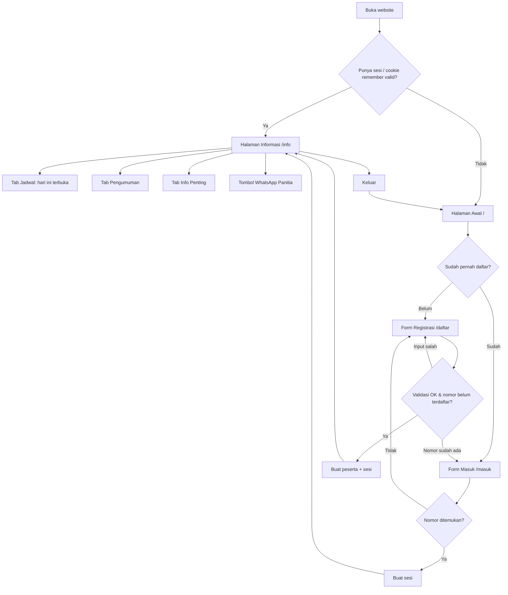
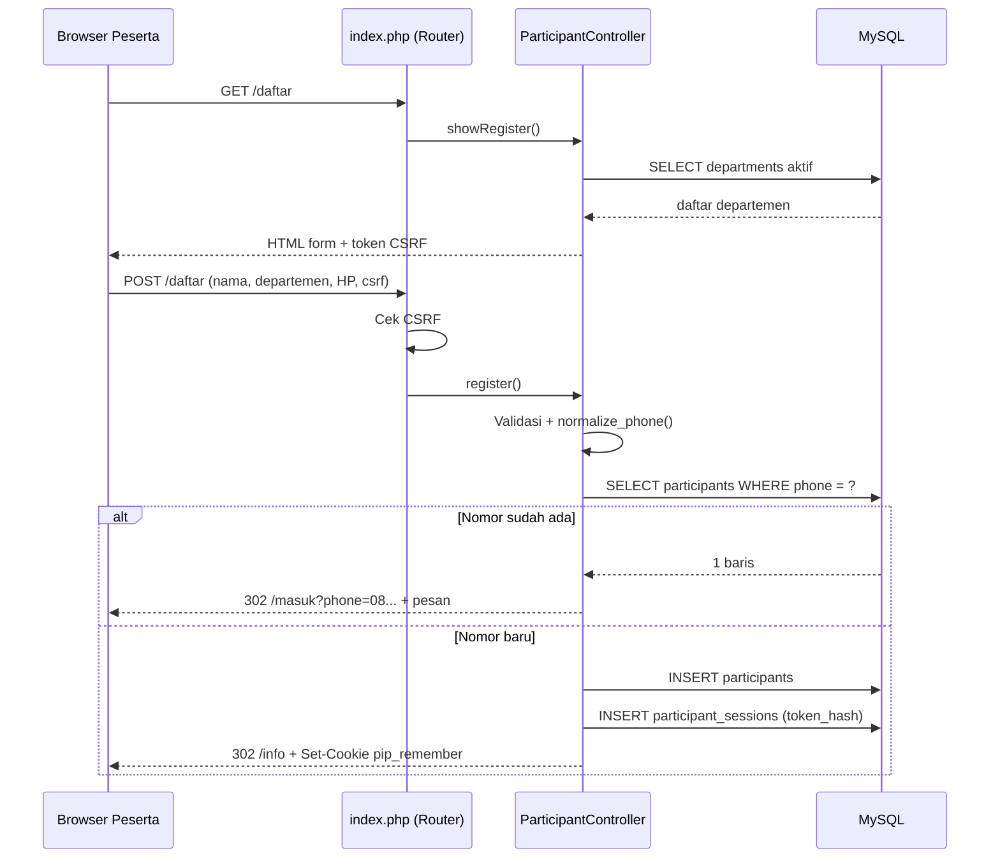
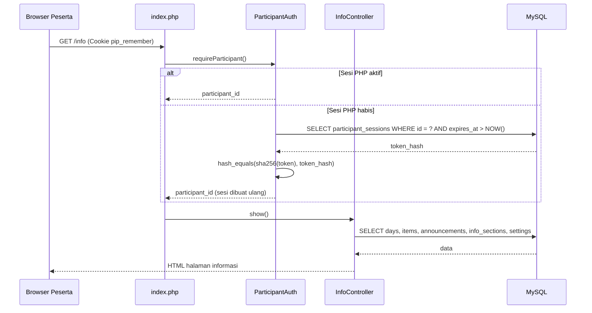
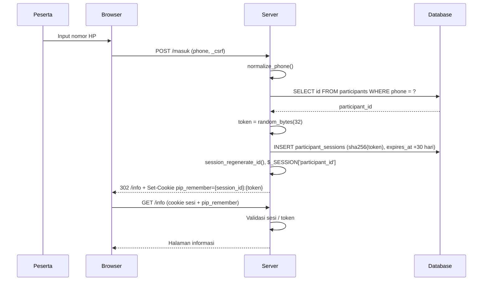
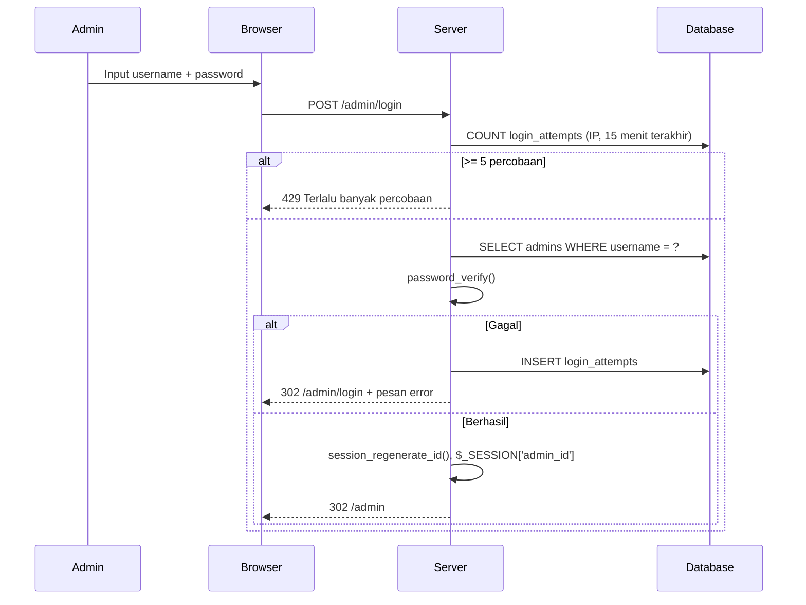

# 📄 Portal Info Peserta — Product Requirement Document

> **Versi:** 1.0
> **Tanggal:** 12 November 2026
> **Author:** taurasanubari (disusun dengan bantuan AI)
> **Status:** Draft
> **Bahasa Dokumen:** Bahasa Indonesia

---

## Daftar Isi

1. [Overview & Requirements](#1-overview--requirements)
2. [Fitur Utama](#2-fitur-utama)
3. [Diagram Visual](#3-diagram-visual)
4. [Arahan Teknis](#4-arahan-teknis-technical-guidelines)

---

## 1. Overview & Requirements

### 1.1 Gambaran Umum Proyek

**Nama Proyek:** Portal Info Peserta (nama kerja, bisa diganti sesuai nama kegiatan klien)
**Deskripsi Singkat:** Website ringan dan mobile-friendly yang menjadi pusat informasi untuk peserta satu kegiatan atau perjalanan. Peserta mendaftar sekali dengan nama, departemen, dan nomor HP/WhatsApp, lalu bisa membuka jadwal, itinerary, agenda, pengumuman, dan informasi penting kapan saja dari HP.
**Jenis Aplikasi:** Web App (server-rendered, mobile-first)

Sumber kebutuhan: proyek "Pembuatan Website Informasi Peserta" di Projects.co.id (owner: Faridahmad). Dokumen ini dipakai untuk membangun MVP yang sekaligus menjadi demo dalam penawaran.

### 1.2 Latar Belakang & Tujuan

**Masalah yang Dipecahkan:**
- Informasi kegiatan (jadwal, titik kumpul, kontak panitia) biasanya tersebar di grup WhatsApp dan cepat tenggelam oleh chat lain, sehingga peserta terus bertanya hal yang sama ke panitia.
- Panitia tidak punya data peserta yang rapi (nama, departemen, nomor HP) dalam satu tempat.
- Perubahan jadwal mendadak sulit disampaikan ke semua peserta secara jelas.

**Tujuan Utama:**
- Peserta bisa menemukan jadwal hari ini dan informasi penting dalam maksimal 2 ketukan setelah membuka website.
- Panitia bisa mengubah jadwal, agenda, dan pengumuman sendiri tanpa coding.
- Panitia bisa mengunduh data peserta ke format yang terbuka di Excel.
- Website tetap cepat di jaringan seluler yang lemah selama perjalanan.

### 1.3 Target Pengguna

| Peran | Deskripsi | Kebutuhan Utama |
|-------|-----------|-----------------|
| Peserta | Karyawan atau anggota yang ikut kegiatan/perjalanan, mengakses dari smartphone, kemampuan teknis beragam | Daftar cepat, masuk lagi tanpa ribet, melihat jadwal hari ini dan info penting |
| Admin (Panitia) | Panitia penyelenggara, biasanya 1–3 orang, mengakses dari HP atau laptop | Mengelola isi jadwal, pengumuman, info penting, daftar departemen, dan melihat/mengunduh data peserta |

### 1.4 Ruang Lingkup (Scope)

**Dalam Scope:**
- Satu kegiatan per instalasi website
- Registrasi peserta (nama lengkap, departemen, nomor HP/WhatsApp)
- Masuk kembali dengan nomor HP terdaftar, tanpa password, dengan sesi tersimpan 30 hari
- Halaman informasi: jadwal per hari, itinerary, pengumuman, info penting
- Panel admin: kelola jadwal, itinerary, pengumuman, info penting, departemen, pengaturan acara, data peserta
- Ekspor data peserta ke CSV yang bisa dibuka di Excel
- Tombol hubungi panitia via WhatsApp
- Pemasangan di domain dan hosting milik klien

**Di Luar Scope:**
- Banyak kegiatan dalam satu website (multi-event)
- Verifikasi nomor HP dengan OTP SMS/WhatsApp
- Notifikasi otomatis ke WhatsApp atau email
- Pembayaran atau tiket
- Aplikasi Android/iOS native
- Check-in dengan QR code
- Pengadaan domain dan hosting (disediakan klien)

### 1.5 Kebutuhan Fungsional

| ID | Kebutuhan | Prioritas | Deskripsi |
|----|-----------|-----------|-----------|
| FR-001 | Registrasi peserta | Must Have | Form nama lengkap, departemen (dropdown), nomor HP/WhatsApp. Satu nomor HP hanya bisa mendaftar sekali. |
| FR-002 | Masuk dengan nomor HP | Must Have | Peserta terdaftar masuk hanya dengan nomor HP. Sesi disimpan 30 hari di perangkat. |
| FR-003 | Proteksi halaman informasi | Must Have | Halaman informasi hanya bisa dibuka peserta yang sudah registrasi/masuk. |
| FR-004 | Jadwal per hari & itinerary | Must Have | Jadwal dikelompokkan per hari (tab), tiap hari punya rute/itinerary dan daftar kegiatan (jam, kegiatan, lokasi, catatan). Hari ini otomatis terbuka. |
| FR-005 | Pengumuman | Must Have | Daftar pengumuman terbaru, pengumuman yang disematkan tampil paling atas. |
| FR-006 | Info penting | Must Have | Bagian bebas seperti titik kumpul, kontak panitia, barang yang perlu dibawa, aturan perjalanan. |
| FR-007 | Login admin | Must Have | Admin masuk dengan username dan password. |
| FR-008 | Kelola jadwal & itinerary | Must Have | Admin menambah, mengubah, menghapus, mengurutkan hari dan kegiatan. |
| FR-009 | Kelola pengumuman & info penting | Must Have | CRUD pengumuman (dengan opsi sematkan) dan bagian info penting. |
| FR-010 | Data peserta | Must Have | Admin melihat daftar peserta, mencari, memfilter per departemen, menghapus peserta. |
| FR-011 | Ekspor peserta | Must Have | Unduh data peserta sebagai CSV yang terbuka rapi di Excel. |
| FR-012 | Kelola departemen | Must Have | CRUD daftar departemen yang tampil di dropdown registrasi. |
| FR-013 | Pengaturan acara | Should Have | Nama kegiatan, tanggal mulai–selesai, nomor WhatsApp panitia, warna utama, buka/tutup registrasi. |
| FR-014 | Tombol WhatsApp panitia | Should Have | Tombol mengambang di halaman informasi yang membuka chat WhatsApp ke panitia. |
| FR-015 | Ganti password admin | Should Have | Admin bisa mengganti password sendiri. |
| FR-016 | Dashboard admin | Could Have | Ringkasan jumlah peserta total dan per departemen. |

### 1.6 Kebutuhan Non-Fungsional

| ID | Kategori | Kebutuhan | Detail |
|----|----------|-----------|--------|
| NFR-001 | Performa | Halaman ringan | Total ukuran halaman peserta di bawah 150 KB (tanpa gambar dari admin). Tanpa framework JS. Satu file CSS dan satu file JS. |
| NFR-002 | Performa | Cepat di jaringan seluler | Halaman informasi tampil di bawah 3 detik pada koneksi 4G lemah/3G. Aset statis diberi cache header. |
| NFR-003 | Kompatibilitas | Mobile-first | Tampilan dirancang mulai lebar 360 px. Berjalan di Chrome Android dan Safari iOS dua versi terakhir, juga desktop. |
| NFR-004 | Keamanan | Proteksi input | Semua query memakai PDO prepared statement. Semua output di-escape dengan `htmlspecialchars`. Semua form POST memakai token CSRF. |
| NFR-005 | Keamanan | Akun admin | Password disimpan dengan `password_hash()` (bcrypt). Login admin dibatasi 5 percobaan gagal per 15 menit per IP. |
| NFR-006 | Keamanan | Sesi | Cookie `HttpOnly`, `Secure` (saat HTTPS), `SameSite=Lax`. Token sesi peserta disimpan dalam bentuk hash SHA-256. |
| NFR-007 | Privasi | Data peserta tertutup | Peserta tidak pernah bisa melihat data peserta lain. Hanya admin yang melihat daftar peserta. |
| NFR-008 | Skalabilitas | Kapasitas | Lancar untuk hingga 1.000 peserta dan 100 akses bersamaan di shared hosting standar. |
| NFR-009 | Portabilitas | Shared hosting | Berjalan di PHP 8.1+ dan MySQL 5.7+/MariaDB 10.4+ tanpa Composer, tanpa akses SSH, cukup lewat cPanel. |
| NFR-010 | Kemudahan | Ramah awam | Teks antarmuka dalam Bahasa Indonesia sederhana. Pesan error menjelaskan apa yang harus dilakukan. |

### 1.7 Asumsi & Batasan

**Asumsi:**
- Klien menyediakan domain dan hosting dengan PHP 8.1+, MySQL/MariaDB, dan SSL (HTTPS).
- Satu instalasi melayani satu kegiatan.
- Isi jadwal dan informasi tidak bersifat rahasia, sehingga masuk dengan nomor HP tanpa password sudah cukup aman.
- Panitia yang akan mengisi konten, developer menyiapkan data contoh.

**Batasan:**
- Nomor HP bukan rahasia. Orang yang mengetahui nomor HP peserta terdaftar bisa membuka halaman informasi. Ini diterima karena halaman tersebut tidak menampilkan data pribadi siapa pun.
- Tidak ada verifikasi bahwa nomor HP benar-benar milik pendaftar.
- Jika klien meminta stack WordPress, dokumen ini perlu direvisi pada bagian 1.8 dan 4.

### 1.8 Tech Stack

| Layer | Teknologi | Justifikasi |
|-------|-----------|-------------|
| Frontend | HTML5 server-rendered + CSS murni (custom properties) + JavaScript vanilla seperlunya | Sangat ringan di HP, tidak perlu proses build, mudah dipahami dan dirawat |
| Backend | PHP 8.1+ native dengan front controller dan router sederhana | Sesuai permintaan klien (PHP), berjalan di semua shared hosting, tidak butuh Composer |
| Database | MySQL 5.7+ / MariaDB 10.4+ via PDO | Tersedia di hampir semua hosting cPanel |
| Deployment | Shared hosting milik klien (cPanel), upload via File Manager/FTP, impor SQL via phpMyAdmin | Sesuai ketentuan klien: domain dan hosting dari klien |
| Lainnya | Font sistem (tanpa Google Fonts), ikon SVG inline | Menghindari request eksternal agar tetap cepat di jaringan lemah |

---

## 2. Fitur Utama

### 2.1 Ringkasan Fitur

| No | Fitur | Prioritas | Status |
|----|-------|-----------|--------|
| 1 | Registrasi Peserta | 🔴 Must Have | Planned |
| 2 | Masuk dengan Nomor HP & Sesi Tersimpan | 🔴 Must Have | Planned |
| 3 | Halaman Informasi (Jadwal, Itinerary, Pengumuman, Info Penting) | 🔴 Must Have | Planned |
| 4 | Login & Keamanan Admin | 🔴 Must Have | Planned |
| 5 | Kelola Jadwal & Itinerary | 🔴 Must Have | Planned |
| 6 | Kelola Pengumuman & Info Penting | 🔴 Must Have | Planned |
| 7 | Data Peserta & Ekspor CSV | 🔴 Must Have | Planned |
| 8 | Kelola Departemen | 🔴 Must Have | Planned |
| 9 | Pengaturan Acara | 🟡 Should Have | Planned |
| 10 | Tombol WhatsApp Panitia | 🟡 Should Have | Planned |
| 11 | Dashboard Ringkasan Admin | 🟢 Could Have | Planned |
| 12 | Multi-event, OTP, notifikasi otomatis, QR check-in | ⚪ Won't Have (versi ini) | Not Planned |

### 2.2 Detail Fitur

#### 2.2.1 Registrasi Peserta

**Deskripsi:** Halaman form registrasi berisi tiga field: Nama lengkap (teks), Departemen (dropdown dari tabel `departments` yang aktif), dan Nomor HP/WhatsApp (input `type="tel"`). Setelah berhasil, peserta langsung masuk dan diarahkan ke halaman informasi. Admin bisa menutup registrasi lewat pengaturan.

**User Stories:**
- Sebagai peserta, saya ingin mendaftar hanya dengan nama, departemen, dan nomor HP, agar bisa langsung melihat jadwal tanpa membuat akun yang rumit.
- Sebagai panitia, saya ingin departemen dipilih dari daftar, agar data peserta seragam dan mudah dikelompokkan.
- Sebagai panitia, saya ingin satu nomor HP hanya bisa mendaftar sekali, agar tidak ada data ganda.

**Acceptance Criteria:**
- [ ] Semua field wajib diisi. Nama lengkap 3–100 karakter.
- [ ] Dropdown hanya menampilkan departemen yang aktif, diurutkan berdasarkan `sort_order`.
- [ ] Nomor HP dinormalisasi sebelum disimpan: karakter non-angka dibuang, awalan `+62`/`62` diubah menjadi `0`. Hasil harus diawali `08` dan panjang 10–14 digit.
- [ ] Jika nomor HP sudah terdaftar, form menampilkan pesan "Nomor ini sudah terdaftar. Silakan masuk." beserta tautan ke halaman masuk dengan nomor sudah terisi.
- [ ] Jika gagal validasi, nilai yang sudah diisi tetap ada dan pesan error tampil di bawah field terkait.
- [ ] Setelah berhasil, sesi peserta dibuat (lihat 2.2.2) dan peserta diarahkan ke `/info`.
- [ ] Jika registrasi ditutup admin, halaman `/daftar` menampilkan pesan "Registrasi sudah ditutup" dan tautan ke halaman masuk.

**Catatan Teknis:**
- Kolom `participants.phone` memakai UNIQUE index. Tangkap error duplikat (SQLSTATE 23000) sebagai pengaman kedua setelah pengecekan di aplikasi.
- Fungsi `normalize_phone(string $raw): ?string` di `app/helpers.php` mengembalikan `null` jika format tidak valid.

---

#### 2.2.2 Masuk dengan Nomor HP & Sesi Tersimpan

**Deskripsi:** Peserta yang sudah terdaftar cukup memasukkan nomor HP untuk masuk. Sesi disimpan lewat cookie "remember" selama 30 hari, sehingga peserta tidak perlu masuk ulang setiap membuka website, walaupun sesi PHP di shared hosting sudah kedaluwarsa.

**User Stories:**
- Sebagai peserta, saya ingin masuk hanya dengan nomor HP, agar tidak perlu mengingat password selama perjalanan.
- Sebagai peserta, saya ingin tetap masuk ketika membuka website lagi besok, agar bisa langsung melihat jadwal.
- Sebagai peserta, saya ingin bisa keluar, agar HP yang dipinjam orang lain tidak tetap masuk dengan akun saya.

**Acceptance Criteria:**
- [ ] Halaman `/masuk` berisi satu field nomor HP dan tombol "Masuk".
- [ ] Nomor dinormalisasi dengan aturan yang sama seperti registrasi.
- [ ] Jika nomor tidak ditemukan, tampil pesan "Nomor belum terdaftar." dengan tautan ke `/daftar`.
- [ ] Jika ditemukan, dibuat token acak 32 byte, hash SHA-256-nya disimpan di `participant_sessions` dengan masa berlaku 30 hari, dan cookie `pip_remember` berisi `{session_id}:{token}` dikirim ke browser.
- [ ] Saat mengakses halaman terproteksi tanpa sesi PHP aktif, aplikasi memeriksa cookie `pip_remember`, mencocokkan hash, dan membuat ulang sesi jika valid dan belum kedaluwarsa.
- [ ] Peserta bisa masuk di lebih dari satu perangkat (satu baris `participant_sessions` per perangkat).
- [ ] Tombol "Keluar" menghapus baris sesi terkait, menghapus cookie, dan mengarahkan ke `/`.
- [ ] Peserta yang sudah masuk lalu membuka `/`, `/daftar`, atau `/masuk` langsung diarahkan ke `/info`.

**Catatan Teknis:**
- Gunakan `random_bytes(32)` dan `hash_equals()` untuk perbandingan token.
- Panggil `session_regenerate_id(true)` setiap kali peserta masuk atau registrasi.
- Kolom `participants.last_login_at` diperbarui setiap login.

---

#### 2.2.3 Halaman Informasi (Jadwal, Itinerary, Pengumuman, Info Penting)

**Deskripsi:** Halaman utama peserta di `/info`. Bagian atas menampilkan nama kegiatan, tanggal, dan sapaan "Halo, {nama depan}". Di bawahnya ada navigasi bawah (bottom navigation) dengan tiga tab: Jadwal, Pengumuman, Info. Tab Jadwal menampilkan tab per hari (Hari 1, Hari 2, dan seterusnya). Setiap hari punya judul, tanggal, rute itinerary (misalnya "Lamongan → Malang"), dan daftar kegiatan berurutan berdasarkan jam.

**User Stories:**
- Sebagai peserta, saya ingin jadwal hari ini langsung terbuka, agar tidak perlu mencari-cari.
- Sebagai peserta, saya ingin melihat rute perjalanan tiap hari, agar tahu ke mana saja rombongan akan pergi.
- Sebagai peserta, saya ingin melihat pengumuman terbaru di satu tempat, agar tidak ketinggalan perubahan jadwal.
- Sebagai peserta, saya ingin melihat titik kumpul dan kontak panitia dengan cepat, agar tahu harus ke mana dan menghubungi siapa.

**Acceptance Criteria:**
- [ ] Hanya bisa diakses peserta yang sudah masuk. Pengunjung tanpa sesi diarahkan ke `/`.
- [ ] Jika tanggal hari ini sama dengan `schedule_days.date`, tab hari tersebut terbuka otomatis dan diberi label "Hari ini". Jika tidak ada yang cocok, tab Hari 1 terbuka.
- [ ] Setiap kegiatan menampilkan jam mulai (dan jam selesai jika ada), nama kegiatan, lokasi, dan catatan (jika ada).
- [ ] Jika lokasi diisi, ada tautan "Buka di Maps" ke `https://www.google.com/maps/search/?api=1&query={lokasi}`.
- [ ] Tab Pengumuman menampilkan pengumuman yang disematkan di atas, lalu sisanya dari yang terbaru. Setiap pengumuman menampilkan judul, isi, dan waktu terbit.
- [ ] Tab Pengumuman menampilkan titik penanda jika ada pengumuman yang terbit dalam 24 jam terakhir.
- [ ] Tab Info menampilkan bagian `info_sections` berurutan berdasarkan `sort_order`, masing-masing bisa dibuka-tutup (accordion).
- [ ] Teks isi pengumuman dan info penting mendukung baris baru dan tautan otomatis (URL menjadi link). HTML dari admin tidak dirender mentah.
- [ ] Perpindahan tab tidak memuat ulang halaman (JS vanilla), dan tetap berfungsi tanpa JS (semua bagian tampil berurutan).
- [ ] Jika belum ada jadwal, tampil pesan "Jadwal akan segera diumumkan."

**Catatan Teknis:**
- Satu request mengambil semua data yang dibutuhkan (hari, kegiatan, pengumuman, info) dengan 4 query sederhana, lalu dirender di server.
- Fungsi `format_text(string $s): string` melakukan escape, `nl2br`, lalu mengubah URL menjadi `<a target="_blank" rel="noopener">`.
- Zona waktu aplikasi diatur ke `Asia/Jakarta` (bisa diganti via env).

---

#### 2.2.4 Login & Keamanan Admin

**Deskripsi:** Panel admin di `/admin` dilindungi username dan password. Akun admin pertama dibuat lewat file seed atau skrip instalasi.

**User Stories:**
- Sebagai panitia, saya ingin masuk ke panel admin dengan username dan password, agar hanya panitia yang bisa mengubah informasi.
- Sebagai panitia, saya ingin bisa mengganti password, agar akun tetap aman setelah serah terima dari developer.

**Acceptance Criteria:**
- [ ] Semua rute di bawah `/admin` (kecuali `/admin/login`) mewajibkan sesi admin.
- [ ] Password diverifikasi dengan `password_verify()`.
- [ ] Setelah 5 percobaan gagal dari IP yang sama dalam 15 menit, login ditolak dengan pesan "Terlalu banyak percobaan. Coba lagi dalam 15 menit." (HTTP 429).
- [ ] Sesi admin kedaluwarsa setelah 2 jam tanpa aktivitas.
- [ ] Halaman ganti password meminta password lama, password baru (minimal 8 karakter), dan konfirmasi.
- [ ] Sesi admin dan sesi peserta terpisah (key sesi berbeda).

**Catatan Teknis:**
- Percobaan login dicatat di tabel `login_attempts`. Baris lebih dari 1 hari dihapus secara oportunistik saat login.
- README berisi instruksi mengganti password default segera setelah instalasi.

---

#### 2.2.5 Kelola Jadwal & Itinerary

**Deskripsi:** Admin mengelola hari (`schedule_days`) dan kegiatan di dalamnya (`schedule_items`). Itinerary disimpan sebagai rute per hari.

**User Stories:**
- Sebagai panitia, saya ingin menambah hari dan kegiatan beserta jam dan lokasi, agar peserta tahu urutan acara.
- Sebagai panitia, saya ingin mengubah jam kegiatan dengan cepat dari HP, agar perubahan mendadak langsung terlihat peserta.

**Acceptance Criteria:**
- [ ] Admin bisa menambah, mengubah, menghapus hari dengan field: nomor hari, tanggal, judul (contoh: "Berangkat ke Malang"), rute itinerary (opsional).
- [ ] Admin bisa menambah, mengubah, menghapus kegiatan dengan field: hari, jam mulai, jam selesai (opsional), nama kegiatan, lokasi (opsional), catatan (opsional).
- [ ] Kegiatan di halaman peserta diurutkan berdasarkan jam mulai, lalu `sort_order`.
- [ ] Menghapus hari meminta konfirmasi dan ikut menghapus semua kegiatan di hari itu.
- [ ] Form admin nyaman dipakai di HP (input `type="date"` dan `type="time"`).

**Catatan Teknis:**
- Relasi `schedule_items.day_id` memakai `ON DELETE CASCADE`.
- Validasi jam selesai harus lebih besar dari jam mulai jika diisi.

---

#### 2.2.6 Kelola Pengumuman & Info Penting

**Deskripsi:** Admin membuat pengumuman (judul, isi, sematkan atau tidak) dan bagian info penting (judul, isi, urutan).

**User Stories:**
- Sebagai panitia, saya ingin menyematkan pengumuman penting, agar selalu tampil paling atas.
- Sebagai panitia, saya ingin menulis info titik kumpul, kontak, dan barang bawaan sebagai bagian terpisah, agar peserta mudah menemukannya.

**Acceptance Criteria:**
- [ ] CRUD pengumuman dengan field: judul (maks 150 karakter), isi (teks), sematkan (checkbox).
- [ ] `published_at` terisi otomatis saat dibuat.
- [ ] CRUD info penting dengan field: judul, isi, urutan.
- [ ] Data contoh info penting tersedia saat instalasi: "Titik Kumpul", "Kontak Panitia", "Barang yang Perlu Dibawa", "Aturan Selama Perjalanan".
- [ ] Perubahan langsung terlihat di halaman peserta setelah disimpan.

**Catatan Teknis:**
- Isi disimpan sebagai teks biasa dan dirender dengan `format_text()`, bukan HTML mentah, untuk mencegah XSS.

---

#### 2.2.7 Data Peserta & Ekspor CSV

**Deskripsi:** Admin melihat daftar peserta dalam tabel, bisa mencari dan memfilter, menghapus peserta, serta mengunduh data dalam format CSV.

**User Stories:**
- Sebagai panitia, saya ingin melihat siapa saja yang sudah mendaftar, agar bisa mengecek kehadiran per departemen.
- Sebagai panitia, saya ingin mengunduh data peserta ke Excel, agar bisa diolah untuk absensi, kamar, atau bus.

**Acceptance Criteria:**
- [ ] Tabel menampilkan nomor urut, nama lengkap, departemen, nomor HP, dan waktu registrasi, diurutkan dari yang terbaru.
- [ ] Pencarian berdasarkan nama atau nomor HP. Filter berdasarkan departemen.
- [ ] Paginasi 50 baris per halaman.
- [ ] Nomor HP di tabel bisa diketuk untuk membuka WhatsApp (`https://wa.me/62...`).
- [ ] Menghapus peserta meminta konfirmasi dan ikut menghapus sesi peserta tersebut.
- [ ] Tombol "Unduh Excel (CSV)" menghasilkan file `peserta-{YYYYMMDD-HHmm}.csv` mengikuti filter yang sedang aktif.
- [ ] File CSV memakai UTF-8 dengan BOM, delimiter sesuai `CSV_DELIMITER` (default `;` agar terbaca benar di Excel berlokal Indonesia), dan nomor HP tidak kehilangan angka 0 di depan saat dibuka di Excel.

**Catatan Teknis:**
- Nomor HP ditulis sebagai `="08123456789"` di CSV agar Excel memperlakukannya sebagai teks.
- Ekspor di-stream dengan `fputcsv()` ke `php://output` agar hemat memori.

---

#### 2.2.8 Kelola Departemen

**Deskripsi:** Admin mengatur daftar departemen yang muncul di dropdown registrasi.

**User Stories:**
- Sebagai panitia, saya ingin mengatur daftar departemen sendiri, agar sesuai struktur organisasi kami.

**Acceptance Criteria:**
- [ ] CRUD departemen dengan field: nama (unik), urutan, aktif/nonaktif.
- [ ] Departemen yang sudah dipakai peserta tidak bisa dihapus, hanya bisa dinonaktifkan. Pesan yang tampil: "Departemen ini sudah dipakai {n} peserta. Nonaktifkan saja."
- [ ] Departemen nonaktif tidak muncul di form registrasi, tapi tetap tampil di data peserta lama.

**Catatan Teknis:**
- `participants.department_id` memakai `ON DELETE RESTRICT`.

---

#### 2.2.9 Pengaturan Acara

**Deskripsi:** Satu halaman pengaturan untuk identitas kegiatan dan perilaku website.

**User Stories:**
- Sebagai panitia, saya ingin mengubah nama kegiatan dan warna utama, agar website sesuai identitas acara kami.
- Sebagai panitia, saya ingin menutup registrasi setelah batas waktu, agar tidak ada pendaftar baru.

**Acceptance Criteria:**
- [ ] Field: nama kegiatan, subjudul (opsional), tanggal mulai, tanggal selesai, nomor WhatsApp panitia, warna utama (color picker), registrasi dibuka (ya/tidak).
- [ ] Warna utama diterapkan lewat CSS custom property `--color-primary` di seluruh halaman.
- [ ] Nama kegiatan tampil di judul halaman (`<title>`) dan header.

**Catatan Teknis:**
- Disimpan di tabel `settings` (key-value) dan di-cache dalam satu array per request.

---

#### 2.2.10 Tombol WhatsApp Panitia

**Deskripsi:** Tombol bulat mengambang di pojok kanan bawah halaman informasi untuk menghubungi panitia.

**User Stories:**
- Sebagai peserta, saya ingin menghubungi panitia dengan satu ketukan, agar cepat mendapat bantuan saat tertinggal rombongan.

**Acceptance Criteria:**
- [ ] Tombol hanya tampil jika nomor WhatsApp panitia diisi di pengaturan.
- [ ] Membuka `https://wa.me/{nomor_62}?text=Halo panitia, saya {nama} dari {departemen}.`
- [ ] Tidak menutupi navigasi bawah maupun konten penting.

**Catatan Teknis:**
- Nomor dikonversi dari format `08...` ke `628...` dengan fungsi `to_wa_number()`.

---

#### 2.2.11 Dashboard Ringkasan Admin

**Deskripsi:** Halaman awal admin berisi ringkasan singkat.

**User Stories:**
- Sebagai panitia, saya ingin melihat jumlah pendaftar per departemen sekilas, agar tahu departemen mana yang belum lengkap.

**Acceptance Criteria:**
- [ ] Menampilkan total peserta, pendaftar 24 jam terakhir, dan jumlah per departemen dalam tabel.
- [ ] Menampilkan tautan cepat ke kelola jadwal, pengumuman, dan data peserta.

**Catatan Teknis:**
- Cukup satu query `GROUP BY department_id`.

---

## 3. Diagram Visual

### 3.1 System Architecture



### 3.2 Entity Relationship Diagram (ERD)



### 3.3 User Flow Diagram

**Alur Peserta:**



**Alur Admin:**

```mermaid
flowchart TD
    A[/admin/login] --> B{Kredensial benar?}
    B -->|Tidak, < 5 kali| A
    B -->|Tidak, >= 5 kali| X[Diblokir 15 menit]
    B -->|Ya| C[Dashboard]
    C --> D[Kelola Jadwal & Itinerary]
    C --> E[Kelola Pengumuman]
    C --> F[Kelola Info Penting]
    C --> G[Data Peserta]
    G --> H[Cari / Filter]
    G --> I[Unduh CSV]
    C --> J[Kelola Departemen]
    C --> K[Pengaturan Acara]
    C --> L[Ganti Password]
    C --> M[Keluar]
```

### 3.4 API Flow Diagram

Aplikasi ini server-rendered, jadi "API" berupa request form HTML (GET/POST) yang dijawab dengan halaman atau redirect.

**Registrasi Peserta:**



**Akses Halaman Informasi dengan Cookie Remember:**



---

## 4. Arahan Teknis (Technical Guidelines)

### 4.1 Struktur Folder Proyek

```
portal-info-peserta/
├── public/                     # Document root (isi folder ini yang diakses publik)
│   ├── index.php               # Front controller: load bootstrap, jalankan router
│   ├── .htaccess               # Rewrite semua request ke index.php, cache header aset
│   └── assets/
│       ├── css/app.css         # Satu file CSS, mobile-first
│       ├── js/app.js           # Tab, accordion, konfirmasi hapus
│       └── img/                # Favicon, ikon
├── app/
│   ├── bootstrap.php           # Load .env, set timezone, error handler, mulai sesi
│   ├── config.php              # Baca env ke array konfigurasi
│   ├── routes.php              # Daftar rute: method + path => [Controller, method, middleware]
│   ├── Core/
│   │   ├── Router.php          # Pencocokan path sederhana, dukung {id}
│   │   ├── Database.php        # Singleton PDO (ERRMODE_EXCEPTION, utf8mb4)
│   │   ├── View.php            # render($template, $data, $layout)
│   │   ├── Csrf.php            # Buat dan verifikasi token CSRF
│   │   ├── Flash.php           # Pesan sekali tampil + old input
│   │   └── Validator.php       # Aturan validasi sederhana
│   ├── Auth/
│   │   ├── ParticipantAuth.php # Login peserta, cookie remember, logout
│   │   └── AdminAuth.php       # Login admin, rate limit, timeout
│   ├── Controllers/
│   │   ├── HomeController.php
│   │   ├── ParticipantController.php   # daftar, masuk, keluar
│   │   ├── InfoController.php          # halaman informasi
│   │   └── Admin/
│   │       ├── AuthController.php
│   │       ├── DashboardController.php
│   │       ├── ScheduleDayController.php
│   │       ├── ScheduleItemController.php
│   │       ├── AnnouncementController.php
│   │       ├── InfoSectionController.php
│   │       ├── ParticipantController.php
│   │       ├── DepartmentController.php
│   │       ├── SettingController.php
│   │       └── AccountController.php
│   ├── Models/                 # Query per tabel (static method, PDO prepared)
│   │   ├── Participant.php
│   │   ├── ParticipantSession.php
│   │   ├── Department.php
│   │   ├── ScheduleDay.php
│   │   ├── ScheduleItem.php
│   │   ├── Announcement.php
│   │   ├── InfoSection.php
│   │   ├── Setting.php
│   │   ├── Admin.php
│   │   └── LoginAttempt.php
│   ├── helpers.php             # e(), normalize_phone(), to_wa_number(), format_text(), redirect(), url()
│   └── Views/
│       ├── layouts/
│       │   ├── participant.php
│       │   └── admin.php
│       ├── participant/
│       │   ├── home.php
│       │   ├── register.php
│       │   ├── login.php
│       │   └── info.php
│       ├── admin/              # Satu folder per modul: index.php, form.php
│       └── errors/
│           ├── 404.php
│           ├── 419.php
│           ├── 429.php
│           └── 500.php
├── database/
│   ├── schema.sql              # CREATE TABLE semua tabel
│   └── seed.sql                # Admin default, departemen, data acara contoh
├── storage/
│   └── logs/app.log            # Log error (tidak boleh diakses publik)
├── .env.example
├── .htaccess                   # Untuk hosting yang document root-nya folder proyek: arahkan ke public/, tolak akses app/, database/, storage/, .env
└── README.md                   # Cara instalasi di cPanel dan cara ganti password admin
```

### 4.2 Desain Database

Semua tabel memakai engine InnoDB, charset `utf8mb4`, collation `utf8mb4_unicode_ci`.

#### Tabel: departments

| Kolom | Tipe Data | Constraint | Deskripsi |
|-------|-----------|------------|-----------|
| id | INT UNSIGNED | PK, AUTO_INCREMENT | Primary key |
| name | VARCHAR(100) | NOT NULL, UNIQUE | Nama departemen |
| sort_order | INT | NOT NULL, DEFAULT 0 | Urutan di dropdown |
| is_active | TINYINT(1) | NOT NULL, DEFAULT 1 | 1 = tampil di form registrasi |
| created_at | TIMESTAMP | NOT NULL, DEFAULT CURRENT_TIMESTAMP | Waktu pembuatan |
| updated_at | TIMESTAMP | NOT NULL, DEFAULT CURRENT_TIMESTAMP ON UPDATE CURRENT_TIMESTAMP | Waktu update |

#### Tabel: participants

| Kolom | Tipe Data | Constraint | Deskripsi |
|-------|-----------|------------|-----------|
| id | INT UNSIGNED | PK, AUTO_INCREMENT | Primary key |
| full_name | VARCHAR(100) | NOT NULL | Nama lengkap |
| department_id | INT UNSIGNED | NOT NULL, FK → departments.id ON DELETE RESTRICT | Departemen |
| phone | VARCHAR(16) | NOT NULL, UNIQUE | Nomor HP ternormalisasi, format `08xxxxxxxxxx` |
| last_login_at | TIMESTAMP | NULL | Waktu terakhir masuk |
| created_at | TIMESTAMP | NOT NULL, DEFAULT CURRENT_TIMESTAMP | Waktu registrasi |
| updated_at | TIMESTAMP | NOT NULL, DEFAULT CURRENT_TIMESTAMP ON UPDATE CURRENT_TIMESTAMP | Waktu update |

Index tambahan: `INDEX idx_participants_department (department_id)`, `INDEX idx_participants_created (created_at)`.

#### Tabel: participant_sessions

| Kolom | Tipe Data | Constraint | Deskripsi |
|-------|-----------|------------|-----------|
| id | INT UNSIGNED | PK, AUTO_INCREMENT | Primary key, juga bagian dari isi cookie |
| participant_id | INT UNSIGNED | NOT NULL, FK → participants.id ON DELETE CASCADE | Pemilik sesi |
| token_hash | CHAR(64) | NOT NULL | SHA-256 dari token acak |
| user_agent | VARCHAR(255) | NULL | Info perangkat (untuk referensi) |
| expires_at | DATETIME | NOT NULL | Batas berlaku (30 hari). DATETIME agar MySQL 5.7 tidak menambahkan ON UPDATE otomatis |
| created_at | TIMESTAMP | NOT NULL, DEFAULT CURRENT_TIMESTAMP | Waktu pembuatan |

Index tambahan: `INDEX idx_sessions_expires (expires_at)`.

#### Tabel: schedule_days

| Kolom | Tipe Data | Constraint | Deskripsi |
|-------|-----------|------------|-----------|
| id | INT UNSIGNED | PK, AUTO_INCREMENT | Primary key |
| day_number | TINYINT UNSIGNED | NOT NULL, UNIQUE | Hari ke- (1, 2, 3, ...) |
| date | DATE | NOT NULL | Tanggal hari tersebut |
| title | VARCHAR(150) | NOT NULL | Judul hari, contoh "Berangkat ke Malang" |
| route | VARCHAR(255) | NULL | Rute itinerary, contoh "Lamongan → Batu → Malang" |
| created_at | TIMESTAMP | NOT NULL, DEFAULT CURRENT_TIMESTAMP | Waktu pembuatan |
| updated_at | TIMESTAMP | NOT NULL, DEFAULT CURRENT_TIMESTAMP ON UPDATE CURRENT_TIMESTAMP | Waktu update |

#### Tabel: schedule_items

| Kolom | Tipe Data | Constraint | Deskripsi |
|-------|-----------|------------|-----------|
| id | INT UNSIGNED | PK, AUTO_INCREMENT | Primary key |
| day_id | INT UNSIGNED | NOT NULL, FK → schedule_days.id ON DELETE CASCADE | Hari |
| start_time | TIME | NOT NULL | Jam mulai |
| end_time | TIME | NULL | Jam selesai |
| activity | VARCHAR(150) | NOT NULL | Nama kegiatan |
| location | VARCHAR(200) | NULL | Lokasi |
| notes | TEXT | NULL | Catatan tambahan |
| sort_order | INT | NOT NULL, DEFAULT 0 | Penentu urutan jika jam sama |
| created_at | TIMESTAMP | NOT NULL, DEFAULT CURRENT_TIMESTAMP | Waktu pembuatan |
| updated_at | TIMESTAMP | NOT NULL, DEFAULT CURRENT_TIMESTAMP ON UPDATE CURRENT_TIMESTAMP | Waktu update |

Index tambahan: `INDEX idx_items_day_time (day_id, start_time, sort_order)`.

#### Tabel: announcements

| Kolom | Tipe Data | Constraint | Deskripsi |
|-------|-----------|------------|-----------|
| id | INT UNSIGNED | PK, AUTO_INCREMENT | Primary key |
| title | VARCHAR(150) | NOT NULL | Judul pengumuman |
| body | TEXT | NOT NULL | Isi (teks biasa) |
| is_pinned | TINYINT(1) | NOT NULL, DEFAULT 0 | 1 = selalu di atas |
| published_at | TIMESTAMP | NOT NULL, DEFAULT CURRENT_TIMESTAMP | Waktu terbit |
| created_at | TIMESTAMP | NOT NULL, DEFAULT CURRENT_TIMESTAMP | Waktu pembuatan |
| updated_at | TIMESTAMP | NOT NULL, DEFAULT CURRENT_TIMESTAMP ON UPDATE CURRENT_TIMESTAMP | Waktu update |

#### Tabel: info_sections

| Kolom | Tipe Data | Constraint | Deskripsi |
|-------|-----------|------------|-----------|
| id | INT UNSIGNED | PK, AUTO_INCREMENT | Primary key |
| title | VARCHAR(100) | NOT NULL | Judul bagian, contoh "Titik Kumpul" |
| body | TEXT | NOT NULL | Isi (teks biasa) |
| sort_order | INT | NOT NULL, DEFAULT 0 | Urutan tampil |
| created_at | TIMESTAMP | NOT NULL, DEFAULT CURRENT_TIMESTAMP | Waktu pembuatan |
| updated_at | TIMESTAMP | NOT NULL, DEFAULT CURRENT_TIMESTAMP ON UPDATE CURRENT_TIMESTAMP | Waktu update |

#### Tabel: settings

| Kolom | Tipe Data | Constraint | Deskripsi |
|-------|-----------|------------|-----------|
| setting_key | VARCHAR(50) | PK | Nama pengaturan |
| setting_value | TEXT | NULL | Nilai |
| updated_at | TIMESTAMP | NOT NULL, DEFAULT CURRENT_TIMESTAMP ON UPDATE CURRENT_TIMESTAMP | Waktu update |

Key yang dipakai: `event_name`, `event_subtitle`, `event_start_date`, `event_end_date`, `committee_whatsapp`, `primary_color`, `registration_open` (`1`/`0`).

#### Tabel: admins

| Kolom | Tipe Data | Constraint | Deskripsi |
|-------|-----------|------------|-----------|
| id | INT UNSIGNED | PK, AUTO_INCREMENT | Primary key |
| username | VARCHAR(50) | NOT NULL, UNIQUE | Username login |
| password_hash | VARCHAR(255) | NOT NULL | Hasil `password_hash()` |
| last_login_at | TIMESTAMP | NULL | Waktu terakhir masuk |
| created_at | TIMESTAMP | NOT NULL, DEFAULT CURRENT_TIMESTAMP | Waktu pembuatan |
| updated_at | TIMESTAMP | NOT NULL, DEFAULT CURRENT_TIMESTAMP ON UPDATE CURRENT_TIMESTAMP | Waktu update |

#### Tabel: login_attempts

| Kolom | Tipe Data | Constraint | Deskripsi |
|-------|-----------|------------|-----------|
| id | INT UNSIGNED | PK, AUTO_INCREMENT | Primary key |
| ip_address | VARCHAR(45) | NOT NULL | IP pengirim (IPv4/IPv6) |
| username | VARCHAR(50) | NULL | Username yang dicoba |
| attempted_at | TIMESTAMP | NOT NULL, DEFAULT CURRENT_TIMESTAMP | Waktu percobaan |

Index tambahan: `INDEX idx_attempts_ip_time (ip_address, attempted_at)`.

#### Data Seed (untuk demo)

- Admin: username `admin`, password `GantiSegera123` (wajib diganti setelah instalasi).
- Departemen: Keuangan, HRD, Marketing, Operasional, IT, Produksi.
- Pengaturan: nama kegiatan "Family Gathering 2026", subjudul "Malang – Batu", tanggal 3 hari, warna utama `#0F766E`, registrasi dibuka.
- Jadwal contoh 3 hari: Hari 1 "Berangkat ke Batu" (Lamongan → Batu), Hari 2 "Wisata Batu" (Batu → Jatim Park → Alun-alun Batu), Hari 3 "Pulang" (Batu → Malang → Lamongan), masing-masing 4–6 kegiatan.
- Pengumuman contoh 2 buah, satu disematkan.
- Info penting contoh: Titik Kumpul, Kontak Panitia, Barang yang Perlu Dibawa, Aturan Selama Perjalanan.

### 4.3 API Endpoints

Semua rute dilayani `public/index.php`. Request POST wajib membawa field `_csrf`. Kolom Auth: ❌ publik, 👤 peserta, 🔑 admin.

#### Peserta

| Method | Endpoint | Deskripsi | Auth |
|--------|----------|-----------|------|
| GET | `/` | Halaman awal: nama kegiatan, tombol Daftar dan Masuk. Redirect ke `/info` jika sudah masuk | ❌ |
| GET | `/daftar` | Form registrasi | ❌ |
| POST | `/daftar` | Proses registrasi, buat sesi, redirect `/info` | ❌ |
| GET | `/masuk` | Form masuk (opsional `?phone=` untuk prefill) | ❌ |
| POST | `/masuk` | Proses masuk dengan nomor HP, redirect `/info` | ❌ |
| POST | `/keluar` | Hapus sesi dan cookie, redirect `/` | 👤 |
| GET | `/info` | Halaman informasi (jadwal, pengumuman, info) | 👤 |

#### Admin: Autentikasi & Akun

| Method | Endpoint | Deskripsi | Auth |
|--------|----------|-----------|------|
| GET | `/admin/login` | Form login admin | ❌ |
| POST | `/admin/login` | Proses login (dengan rate limit) | ❌ |
| POST | `/admin/logout` | Logout admin | 🔑 |
| GET | `/admin` | Dashboard ringkasan | 🔑 |
| GET | `/admin/akun` | Form ganti password | 🔑 |
| POST | `/admin/akun` | Simpan password baru | 🔑 |

#### Admin: Jadwal & Itinerary

| Method | Endpoint | Deskripsi | Auth |
|--------|----------|-----------|------|
| GET | `/admin/jadwal` | Daftar hari beserta kegiatan | 🔑 |
| GET | `/admin/jadwal/hari/tambah` | Form tambah hari | 🔑 |
| POST | `/admin/jadwal/hari` | Simpan hari baru | 🔑 |
| GET | `/admin/jadwal/hari/{id}/edit` | Form ubah hari | 🔑 |
| POST | `/admin/jadwal/hari/{id}` | Simpan perubahan hari | 🔑 |
| POST | `/admin/jadwal/hari/{id}/hapus` | Hapus hari dan kegiatannya | 🔑 |
| GET | `/admin/jadwal/kegiatan/tambah?day_id={id}` | Form tambah kegiatan | 🔑 |
| POST | `/admin/jadwal/kegiatan` | Simpan kegiatan baru | 🔑 |
| GET | `/admin/jadwal/kegiatan/{id}/edit` | Form ubah kegiatan | 🔑 |
| POST | `/admin/jadwal/kegiatan/{id}` | Simpan perubahan kegiatan | 🔑 |
| POST | `/admin/jadwal/kegiatan/{id}/hapus` | Hapus kegiatan | 🔑 |

#### Admin: Pengumuman, Info Penting, Departemen

| Method | Endpoint | Deskripsi | Auth |
|--------|----------|-----------|------|
| GET | `/admin/pengumuman` | Daftar pengumuman | 🔑 |
| GET | `/admin/pengumuman/tambah` | Form tambah | 🔑 |
| POST | `/admin/pengumuman` | Simpan baru | 🔑 |
| GET | `/admin/pengumuman/{id}/edit` | Form ubah | 🔑 |
| POST | `/admin/pengumuman/{id}` | Simpan perubahan | 🔑 |
| POST | `/admin/pengumuman/{id}/hapus` | Hapus | 🔑 |
| GET | `/admin/info` | Daftar bagian info penting | 🔑 |
| GET | `/admin/info/tambah` | Form tambah | 🔑 |
| POST | `/admin/info` | Simpan baru | 🔑 |
| GET | `/admin/info/{id}/edit` | Form ubah | 🔑 |
| POST | `/admin/info/{id}` | Simpan perubahan | 🔑 |
| POST | `/admin/info/{id}/hapus` | Hapus | 🔑 |
| GET | `/admin/departemen` | Daftar departemen | 🔑 |
| POST | `/admin/departemen` | Tambah departemen | 🔑 |
| POST | `/admin/departemen/{id}` | Ubah nama, urutan, status aktif | 🔑 |
| POST | `/admin/departemen/{id}/hapus` | Hapus (ditolak jika sudah dipakai) | 🔑 |

#### Admin: Peserta & Pengaturan

| Method | Endpoint | Deskripsi | Auth |
|--------|----------|-----------|------|
| GET | `/admin/peserta?q=&department_id=&page=` | Daftar peserta dengan pencarian, filter, paginasi | 🔑 |
| GET | `/admin/peserta/ekspor?q=&department_id=` | Unduh CSV sesuai filter | 🔑 |
| POST | `/admin/peserta/{id}/hapus` | Hapus peserta | 🔑 |
| GET | `/admin/pengaturan` | Form pengaturan acara | 🔑 |
| POST | `/admin/pengaturan` | Simpan pengaturan | 🔑 |

**Contoh request & response (registrasi):**

```http
POST /daftar HTTP/1.1
Content-Type: application/x-www-form-urlencoded

_csrf=8f1c...&full_name=Rina+Wulandari&department_id=3&phone=0812-3456-7890
```

```http
HTTP/1.1 302 Found
Location: /info
Set-Cookie: pip_remember=42:Zk9...; Expires=Sat, 12 Dec 2026 05:00:00 GMT; Path=/; Secure; HttpOnly; SameSite=Lax
```

**Contoh respons gagal validasi:** HTTP 302 kembali ke `/daftar`, dengan flash error `{"phone": "Nomor HP tidak valid. Contoh: 081234567890"}` dan old input tersimpan di sesi.

### 4.4 Autentikasi & Otorisasi

**Strategi Autentikasi:** Session PHP + cookie remember berbasis token (peserta), Session PHP + password bcrypt (admin).

**Alur Autentikasi Peserta:**



**Alur Autentikasi Admin:**



**Role & Permission:**

| Role | Permissions |
|------|-------------|
| Pengunjung | Melihat halaman awal, registrasi, masuk |
| Peserta | Semua hak pengunjung + melihat halaman informasi + keluar. Tidak bisa melihat data peserta lain |
| Admin | Seluruh panel admin: kelola jadwal, itinerary, pengumuman, info penting, departemen, pengaturan, data peserta, ekspor CSV, ganti password |

### 4.5 Error Handling

Karena aplikasi server-rendered, error ditampilkan sebagai halaman atau pesan flash, bukan JSON.

**Format Pesan Error Form (disimpan di sesi sebagai flash):**

```json
{
  "errors": {
    "full_name": "Nama lengkap wajib diisi.",
    "phone": "Nomor HP tidak valid. Contoh: 081234567890"
  },
  "old": {
    "full_name": "",
    "department_id": "3",
    "phone": "0812"
  }
}
```

**Kode Error Standar:**

| Code | HTTP Status | Deskripsi |
|------|-------------|-----------|
| VALIDATION_ERROR | 302 → form | Input tidak valid, kembali ke form dengan pesan per field |
| PHONE_EXISTS | 302 → `/masuk` | Nomor HP sudah terdaftar saat registrasi |
| PHONE_NOT_FOUND | 302 → `/masuk` | Nomor HP belum terdaftar saat masuk |
| REGISTRATION_CLOSED | 200 | Registrasi ditutup admin, form tidak ditampilkan |
| UNAUTHORIZED | 302 → `/` atau `/admin/login` | Belum masuk |
| NOT_FOUND | 404 | Halaman atau data tidak ditemukan |
| CSRF_MISMATCH | 419 | Token CSRF tidak valid atau kedaluwarsa. Pesan: "Halaman sudah terlalu lama dibuka. Silakan muat ulang dan coba lagi." |
| TOO_MANY_ATTEMPTS | 429 | Rate limit login admin |
| DEPARTMENT_IN_USE | 302 → daftar departemen | Hapus departemen yang masih dipakai peserta |
| INTERNAL_ERROR | 500 | Error server. Detail dicatat di `storage/logs/app.log`, pengguna hanya melihat pesan umum |

Saat `APP_ENV=development`, detail exception boleh ditampilkan di layar. Saat `production`, detail tidak pernah ditampilkan.

### 4.6 Environment Variables

File `.env` dibaca oleh parser sederhana di `app/config.php` (tanpa Composer). File ini tidak boleh bisa diakses dari browser.

```env
# Application
APP_NAME="Portal Info Peserta"
APP_ENV=production
APP_URL=https://info.domainklien.com
APP_TIMEZONE=Asia/Jakarta

# Database
DB_HOST=localhost
DB_PORT=3306
DB_NAME=klien_infopeserta
DB_USER=klien_infopeserta
DB_PASSWORD=isi_password_database

# Session
SESSION_NAME=pip_session
REMEMBER_COOKIE=pip_remember
REMEMBER_DAYS=30
ADMIN_IDLE_MINUTES=120

# Security
LOGIN_MAX_ATTEMPTS=5
LOGIN_LOCK_MINUTES=15

# Export
CSV_DELIMITER=;
```

### 4.7 Panduan Deployment

**Platform:** Shared hosting milik klien dengan cPanel (Apache, PHP 8.1+, MySQL/MariaDB, SSL).

**Langkah Deployment:**
1. Di cPanel, buat database MySQL, user, lalu beri user tersebut semua privilege ke database.
2. Buka phpMyAdmin, impor `database/schema.sql`, lalu `database/seed.sql` (untuk demo) atau seed minimal tanpa data contoh (untuk produksi).
3. Kompres proyek ke `.zip`, unggah lewat File Manager, lalu ekstrak.
4. Atur document root domain/subdomain ke folder `public/`. Jika hosting tidak mengizinkan, letakkan isi `public/` di `public_html/`, folder lainnya satu tingkat di atas `public_html/`, lalu sesuaikan path di `public/index.php`. Jika keduanya tidak bisa, gunakan `.htaccess` di root proyek yang menolak akses ke `app/`, `database/`, `storage/`, dan `.env`.
5. Salin `.env.example` menjadi `.env` dan isi kredensial database serta `APP_URL`.
6. Pastikan folder `storage/logs/` bisa ditulis (permission 755 atau 775).
7. Aktifkan SSL (AutoSSL/Let's Encrypt di cPanel) dan paksa HTTPS di `.htaccess`.
8. Buka `/admin/login`, masuk dengan akun default, lalu langsung ganti password di `/admin/akun`.
9. Uji alur lengkap dari HP: registrasi, keluar, masuk lagi, lihat jadwal, klik tombol WhatsApp.

**Checklist Pre-Deployment:**
- [ ] Semua environment variables sudah di-set dan `APP_ENV=production`
- [ ] `schema.sql` sudah diimpor, seed sesuai kebutuhan (demo/produksi)
- [ ] `.env`, `app/`, `database/`, `storage/` tidak bisa dibuka dari browser (uji dengan membuka URL-nya langsung, harus 403/404)
- [ ] HTTPS aktif dan cookie memakai flag `Secure`
- [ ] Password admin default sudah diganti
- [ ] Uji tampilan di lebar 360 px dan di Safari iOS
- [ ] Ekspor CSV dibuka di Excel: kolom terpisah benar dan angka 0 di depan nomor HP tidak hilang
- [ ] `display_errors` mati di produksi, error tercatat di `storage/logs/app.log`

### 4.8 Integrasi Pihak Ketiga

Tidak ada API pihak ketiga. Integrasi hanya berupa tautan keluar.

| Service | Kegunaan | Dokumentasi |
|---------|----------|-------------|
| WhatsApp Click to Chat (`wa.me`) | Tombol hubungi panitia dan tautan nomor peserta di panel admin | https://faq.whatsapp.com/5913398998672934 |
| Google Maps URLs | Tautan "Buka di Maps" untuk lokasi kegiatan | https://developers.google.com/maps/documentation/urls/get-started |

### 4.9 Urutan Pengerjaan MVP (target 3–5 hari)

| Hari | Pekerjaan | Hasil yang Bisa Dicek |
|------|-----------|------------------------|
| 1 | Struktur folder, `bootstrap.php`, Router, Database, View, Csrf, Flash, `schema.sql`, `seed.sql` | Halaman awal tampil, database terisi data contoh |
| 2 | Registrasi, masuk, cookie remember, keluar, halaman informasi lengkap dengan tab dan accordion, CSS mobile-first | Alur peserta bisa dicoba penuh dari HP |
| 3 | Login admin + rate limit, CRUD jadwal & kegiatan, CRUD pengumuman & info penting | Admin bisa mengubah isi dan langsung terlihat di sisi peserta |
| 4 | Data peserta + pencarian + ekspor CSV, departemen, pengaturan acara, tombol WhatsApp, dashboard | Semua fitur Must dan Should selesai |
| 5 | Uji di beberapa HP, perbaikan tampilan, README instalasi, deploy demo ke hosting gratis yang mendukung PHP + MySQL | Link demo siap ditempel di penawaran Projects.co.id |

---

## 📝 Catatan Revisi

| Versi | Tanggal | Perubahan | Author |
|-------|---------|-----------|--------|
| 1.0 | 12 November 2026 | Dokumen awal berdasarkan brief proyek Projects.co.id dan rekomendasi yang disetujui | taurasanubari (dibantu AI) |
| 1.1 | 12 November 2026 | Kolom participant_sessions.expires_at diubah ke DATETIME | taurasanubari (dibantu AI) |

---

> 📌 **Dokumen ini adalah referensi utama (single source of truth) untuk pengembangan proyek.
> Semua keputusan teknis dan fungsional harus merujuk pada dokumen ini.**
